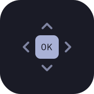
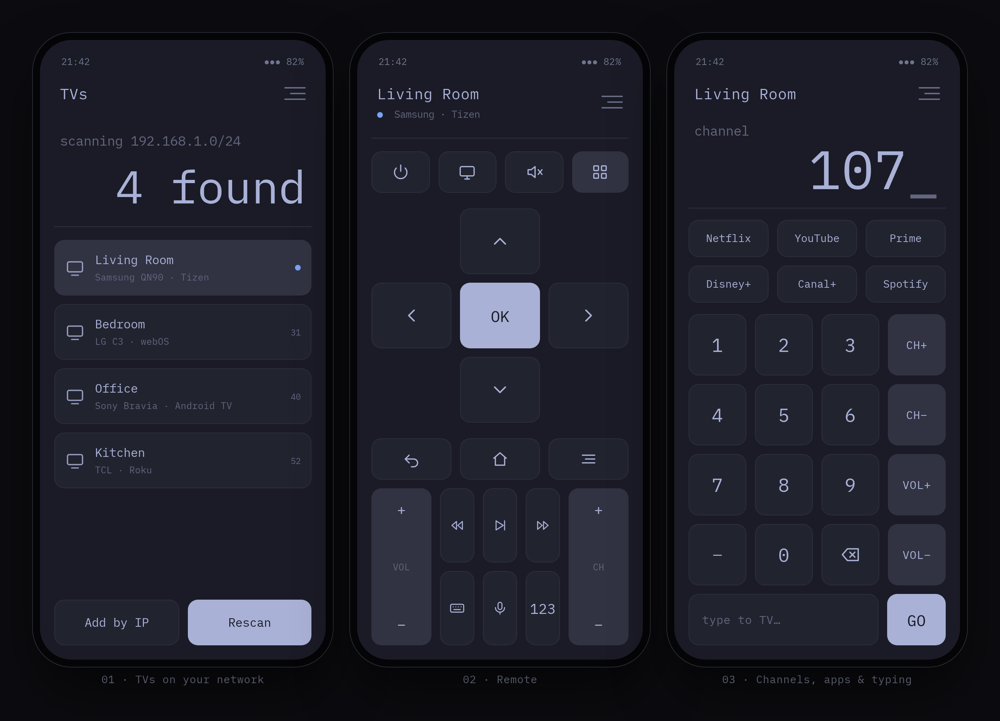

<p align="center">
  <!-- OmaControl - App Icon -->
  <a href="https://github.com/abraham-ukachi/omacontrol" target="_blank">
    
  </a>
</p>


<p align="center" style="width:512px; margin:0 auto;">
  <b>OmaControl</b> is a dead-simple remote for any smart TV (and soon, anything with an IR receiver), written in <b>Rust</b> 🦀 with <b>Omarchy</b>'s look & feel.
</p>

<p align="center" style="margin-top:12px;">
    <a href="https://github.com/abraham-ukachi/omacontrol/releases" target="_blank"><b>Download the APK &rarr;</b></a>
</p>


# `omacontrol`

> IMPORTANT: This is a work in progress and subject to major changes until version 1.0. Android first; Linux (Omarchy) next.


## What is OmaControl? 📺

Picture your living room 🛋️: the Samsung remote is under a cushion, the bedroom LG has its own, the Roku stick wants a third one, and the air conditioner 🥵 hides its remote in a drawer. That's a lot of remotes! 😅

**OmaControl** puts them all in your pocket 📱, in one calm, beautiful app that looks like it shipped with [Omarchy](https://omarchy.org). It finds the TVs on your Wi‑Fi 🔎 (Samsung, LG, Roku and **Android TV / Google TV**, the Freebox Player included), pairs with them once 🤝, and turns your phone into their remote: arrows, OK, volume, channels, media keys, streaming shortcuts (Netflix, YouTube, Prime...) and even **typing** ⌨️ into the TV's search box.

No Wi‑Fi on that old TV? If your phone has an **IR blaster** 🔴 (most Xiaomi, POCO & Redmi phones do), OmaControl speaks infrared too.

And it wears every **Omarchy theme** 🎨: Tokyo Night, Gruvbox, Rose Pine, Flexoki Light... 23 of them, painted exactly like [Omacalc](https://github.com/omacom-io/omacalc): two colors, a few mixes, iA Writer Mono, nothing else.

> MOTTO: We'll always do [**more**](#roadmap-) 😜


---


## Screens 📱



| No. | Screen | What it does |
|:----|:-------|:-------------|
| 1 | *`Devices`* | Scans your network (SSDP + mDNS) behind an ASCII radar, lists every TV and air conditioner found, **Add** by IP or over IR, **Rescan** |
| 2 | *`Remote`* | Power, input, mute, the D-pad with an inverted-ink **OK**, back / home / menu, **VOL** & **CH** rockers, rewind / play / fast-forward, keyboard & number pad shortcuts. Android TVs ask for their **pairing code** here, once |
| 3 | *`Channels & apps`* | A big monospace channel display, **saved channels** (`4002` → **BFMTV**: type the number, **+ save**, name it; tap to tune, **long-press** to rename, **swipe up** to delete), streaming shortcuts, a number pad with CH / VOL keys, and **type to TV** |
| 4 | *`Menu`* | Devices, Remote, Channels & apps, Settings |
| 5 | *`AC`* | Air conditioners over IR: power, mode, fan, − 22° +, sleep & swing |
| 6 | *`AC setup`* | Tries each protocol (Midea, Coolix, Gree, TCL, LG, Electra, Samsung, Kelvinator, Haier, Daikin) until the AC beeps, or tests a pasted IR code |
| 7 | *`Settings`* | **Theme** (all 23 Omarchy themes), **About** (version, author, links) and **Feedback** (an idea or an issue, sent straight to the maintainer's inbox) |

> TIP: Tap the device's name at the top of the Remote, Channels or AC screen to jump back to your devices.


> NOTE: These are the reference mockups (`docs/design`), rendered with the real font and theme colors.


## Supported devices 🔌

| No. | Device | How | Pairing | Status |
|:----|:-------|:----|:--------|:-------|
| 1 | *`Samsung`* (Tizen, 2016+) | Wi‑Fi · secure WebSocket `:8002` | press **Allow** on the TV once | ✅ 0.1.0 |
| 2 | *`LG`* (webOS) | Wi‑Fi · SSAP `:3001` / `:3000` + pointer socket | press **Yes** on the TV once | ✅ 0.1.0 |
| 3 | *`Roku`* / Roku TV | Wi‑Fi · ECP HTTP `:8060` | none | ✅ 0.1.0 |
| 4 | *`Samsung`*, *`LG`*, *`Sony`* | Infrared (phone's IR blaster) | none | ✅ 0.1.0 |
| 5 | *`Air conditioners`* (fixed & portable): Midea, Coolix, Gree, TCL, LG, Electra, Samsung, Kelvinator, Haier and Daikin protocols (Cecotec, Comfee, Kaysun, Toshiba, Beko, TCL, AUX, AEG, De'Longhi, LG, Haier, Daikin...) | Infrared (state-based codes) | tap **Test** until the AC beeps, or paste a Pronto code | 🧪 0.2.2 |
| 6 | *`Android TV`* / Google TV (Freebox Player TV Free 4K, Chromecast with Google TV, Sony, TCL, Philips...) | Wi‑Fi · Android TV Remote v2 `:6467` pairing + `:6466` remote | type the 6-character code the TV shows, once | 🧪 0.3.0 |


## Tech stack & versions 🧰

Versions as built on 2026-11-15:

| Tool | Version | Notes |
|:-----|:--------|:------|
| [Rust](https://www.rust-lang.org) | **stable** (1.100) | Edition 2021. Release profile: `opt-level = "s"`, LTO, stripped. |
| [Slint](https://slint.dev) | **1.x** | The UI (`app/ui/*.slint`). On Android: `backend-android-activity-06` + FemtoVG. |
| [tungstenite](https://github.com/snapview/tungstenite-rs) + [rustls](https://github.com/rustls/rustls) | **0.24** / **0.23** | WebSockets to Samsung & LG (self-signed TV certificates accepted on the LAN only). |
| [ureq](https://github.com/algesten/ureq) | **2.12** | Roku ECP, UPnP descriptions, and the feedback form ([Web3Forms](https://web3forms.com)). |
| [rsa](https://github.com/RustCrypto/RSA) + [rcgen](https://github.com/rustls/rcgen) + [x509-parser](https://github.com/rusticata/x509-parser) | **0.9** / **0.13** / **0.16** | Android TV: our own RSA certificate, and the pairing secret from both certificates. |
| [jni](https://github.com/jni-rs/jni-rs) | **0.21** | Android's `ConsumerIrManager` (the IR blaster). |
| [cargo-apk](https://github.com/rust-mobile/cargo-apk) | latest | Builds the APK (see [`.github/workflows/android.yml`](./.github/workflows/android.yml)). |
| [iA Writer Mono](https://github.com/iaolo/iA-Fonts) | S | The font of Omacalc, bundled under the SIL OFL 1.1. |


## How it works 🦀⚡

| No. | Piece | File | What it does |
|:----|:------|:-----|:-------------|
| 1 | *`Discovery`* | [crates/omacontrol-core/src/discovery.rs](./crates/omacontrol-core/src/discovery.rs) | Sends SSDP `M-SEARCH` for each brand and an mDNS query for `_androidtvremote2._tcp`, tells them apart, reads the TV's friendly name |
| 2 | *`Protocols`* | [crates/omacontrol-core/src/tv/](./crates/omacontrol-core/src/tv) | One module per brand behind the same `Remote` trait (`press`, `type_text`, `launch`). Android TV ([`androidtv.rs`](./crates/omacontrol-core/src/tv/androidtv.rs)) speaks protobuf over TLS with its own certificate, tested end to end against a fake TV |
| 3 | *`Infrared`* | [crates/omacontrol-core/src/ir.rs](./crates/omacontrol-core/src/ir.rs) | NEC, Samsung32, Sony SIRC & Pronto → pulse patterns, plus the TV code sets |
| 4 | *`Air conditioners`* | [crates/omacontrol-core/src/ac.rs](./crates/omacontrol-core/src/ac.rs) | Midea, Coolix, Gree, TCL112, LG, Electra, Samsung, Kelvinator, Haier & Daikin state frames, a pasted Pronto code, and the state the remote keeps (IR is one way) |
| 5 | *`Themes`* | [crates/omacontrol-core/src/theme.rs](./crates/omacontrol-core/src/theme.rs) | The 23 Omarchy themes and Omacalc's color mixing |
| 6 | *`Store`* | [crates/omacontrol-core/src/store.rs](./crates/omacontrol-core/src/store.rs) | Paired TVs, their tokens, saved channels, the Android TV certificate and your theme, in one JSON file (saved atomically, with a backup) |
| 7 | *`Feedback`* | [crates/omacontrol-core/src/feedback.rs](./crates/omacontrol-core/src/feedback.rs) | Settings › Feedback: validates the form and posts it to Web3Forms, which emails it to the maintainer |
| 8 | *`UI`* | [app/ui/](./app/ui) | The seven screens (Devices, Remote, Channels & apps, Menu, AC, AC setup, Settings) and the ASCII scanner, in Slint |
| 9 | *`App`* | [app/src/lib.rs](./app/src/lib.rs) | Wires the UI to the core; a worker thread does all the talking to TVs, the IR blaster and the network |
| 10 | *`Android bits`* | [app/src/android_ir.rs](./app/src/android_ir.rs), [`haptics.rs`](./app/src/haptics.rs), [`android_url.rs`](./app/src/android_url.rs) | The IR blaster (`ConsumerIrManager`), the haptic tick, and opening links, through JNI |


## Build & run 🛠️

```sh
cargo test -p omacontrol-core          # 60 tests, no TV needed
cargo test -p omacontrol-core --release -- --ignored   # + Android TV pairing against a fake TV
cargo run -p omacontrol                # the UI on your desktop
cargo apk run --lib -p omacontrol      # on your Android phone (NDK + cargo-apk)
```

Every push to `main` builds an APK in GitHub Actions (artifact `omacontrol-apk`), and every `v*` tag attaches it to the release.


## Roadmap 🗺️

- [x] 📺 Samsung, LG & Roku over Wi‑Fi
- [x] 🔴 Samsung, LG & Sony over IR
- [x] 🎨 All Omarchy themes
- [x] ❄️ Air conditioners over IR: power, mode, temperature, fan, swing, sleep (fixed & portable)
- [ ] ⏲️ AC timer
- [x] 🤖 Android TV / Google TV (Remote v2 + code pairing)
- [x] 📺 Channels saved by name
- [x] ⚙️ Settings: theme, About, Feedback
- [ ] 📚 More IR code sets (Pronto import, learn from an IR database)
- [ ] 🐧 OmaControl on Omarchy itself (follows the live theme from `~/.local/state/omarchy/current/theme/colors.toml`)
- [ ] 🔊 Soundbars, projectors, set-top boxes...


## More

Made with 🫶🏽 in Marseille by [Abraham Ukachi](https://github.com/abraham-ukachi). Design language from [Omarchy](https://omarchy.org) & [Omacalc](https://github.com/omacom-io/omacalc) by DHH and the Omarchy team (not affiliated).

License: [MIT](./LICENSE).
